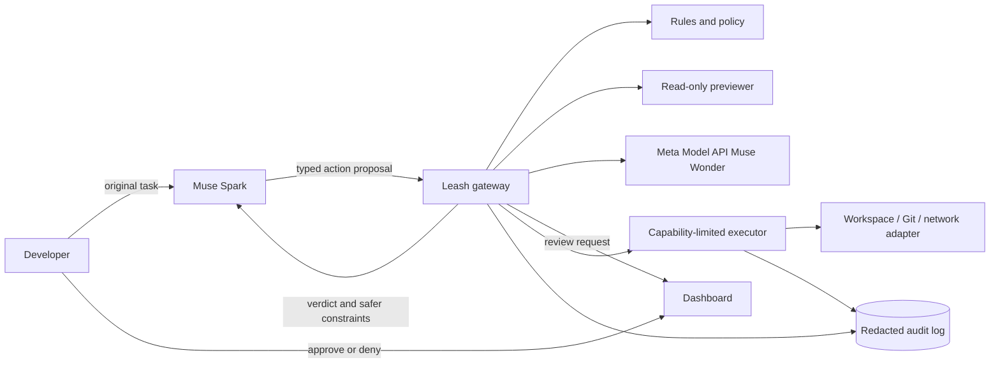
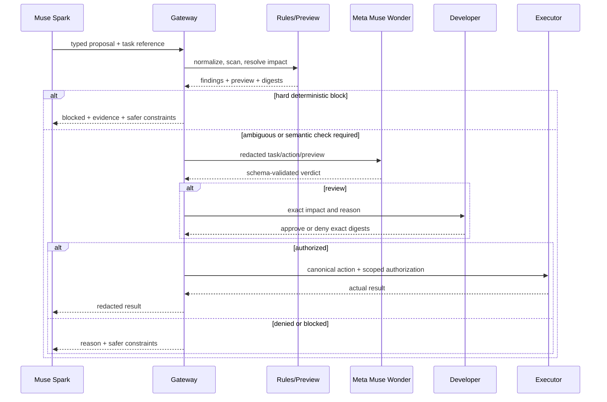

# Leash architecture

Competition requirements and the current submission checklist live in `hackathoninfo.md`. If this document's hackathon assumptions conflict with that file or the accepted Official Rules, update this architecture and follow the newer authoritative requirement.

## 1. Executive summary

Leash is a local policy-enforcement gateway for coding agents. Muse Spark performs high-capability planning in the cloud, but it is not given direct authority to mutate the host. It can only propose typed actions. Leash owns the actual shell, filesystem-write, network-egress, and git-push capabilities and decides whether each exact action may run.

The decision pipeline combines:

1. deterministic policy for fast, explainable checks;
2. a read-only impact preview that resolves what the action would affect;
3. an independent Muse Wonder session through Meta Model API for task alignment and ambiguous intent, receiving only locally redacted context;
4. human review for consequential uncertainty;
5. capability-limited execution and a redacted, integrity-linked audit trail.

This is a **reference monitor for an instrumented agent harness**, not a universal host sandbox. Its guarantees apply only to capabilities exclusively held by Leash.

## 2. Goals and success criteria

### Product goals

- Stop high-confidence destructive or exfiltrating actions before side effects occur.
- Catch task-misaligned behavior, including many prompt-injection outcomes, while keeping raw secrets and full file contents out of the managed judge request.
- Let routine coding actions pass with little or no user interruption.
- Explain decisions with concrete impact: targets, counts, destinations, and policy reasons.
- Give the acting agent actionable denial feedback so it can choose a safer plan.
- Produce reproducible evidence that the hybrid outperforms rules-only and Wonder-only baselines.

### Hackathon success criteria

- A normal Spark coding task completes through the gateway.
- A poisoned-repository scenario proposes secret exfiltration and is stopped before egress.
- An encoded or indirect destructive proposal is decoded or conservatively contained, and its resolved impact is shown.
- The user can approve or deny a genuine `review` action in the dashboard.
- LeashBench produces a versioned report with category metrics and latency.
- The full demo remains understandable in 90 seconds.

## 3. Threat model

### Protected assets

- source code and uncommitted work;
- credentials, tokens, SSH material, environment values, and private configuration;
- repository history and remote branches;
- host filesystem outside the workspace;
- network-accessible services and the user's attention/approval.

### Adversaries and failure sources

- an otherwise capable cloud agent that makes a mistake;
- malicious instructions embedded in files, issues, tool output, or web content;
- obfuscated or indirect commands generated by the agent;
- a compromised or adversarial remote endpoint;
- flawed deterministic rules or an incorrect Muse Wonder judgment;
- accidental approval of an action whose displayed preview differs from execution.

### Trust assumptions

- The local host, Leash process, Meta Model API credential, and policy files are not already compromised.
- Spark can call only Leash proposal tools and cannot invoke a parallel unrestricted shell or network tool.
- Executor credentials and OS permissions are unavailable to Spark and the dashboard.
- User approval is meaningful only when bound to an immutable normalized action and preview.
- Meta Model API and Muse Wonder are external dependencies. Leash minimizes and redacts requests, but sanitized task/action metadata leaves the device.
- Muse Wonder is **not** inherently trustworthy merely because it is a separate model and context.

### Non-guarantees

Leash does not claim to:

- decide the safety of every possible program;
- decode every form of obfuscation;
- prevent actions taken through capabilities outside its gateway;
- eliminate time-of-check/time-of-use races on an unrestricted host;
- detect every novel or fragmented secret;
- prove that a task-aligned action is harmless;
- replace OS sandboxing, containers, least-privilege credentials, or backups.

## 4. System context



The critical boundary is between **proposal** and **authority**. Spark may describe an action but cannot execute it. The executor rejects any request that does not carry a current Leash authorization bound to the same normalized action and preview digest.

## 5. Components

### 5.1 Spark harness

The harness sends the user's immutable original task to Muse Spark through the Meta Model API. Spark receives structured proposal tools such as:

- `propose_shell(argv, cwd, env_names)`;
- `propose_file_write(path, content_ref, mode)`;
- `propose_http(method, url, headers_ref, body_ref)`;
- `propose_git_push(remote, refspec, force_mode)`.

The model does not receive a raw, unrestricted execution tool. After a denial, the harness returns stable reason codes, a plain-language explanation, and constraints for a safer retry.

### 5.2 Gateway and orchestrator

The gateway is the only entry point for proposals. It validates schemas, assigns IDs, carries the original-task reference through every stage, manages decision state, and ensures stages cannot be skipped.

Suggested state machine:

```text
PROPOSED -> NORMALIZED -> PREVIEWED -> JUDGED -> ALLOWED -> EXECUTED
                                     |          |
                                     |          +-> FAILED
                                     +-> REVIEW_PENDING -> APPROVED -> ALLOWED
                                     |                    +-> DENIED
                                     +-> BLOCKED
```

Transitions are append-only audit events. Approval expires and is valid for one action digest, one preview digest, and one execution attempt.

### 5.3 Normalizer

The normalizer converts typed proposal inputs into a canonical representation. It resolves the working directory, canonicalizes paths, classifies executables and shell features, and extracts nested interpreters or encoded payloads where supported.

For the hackathon, support a constrained command grammar. Pipelines, command chaining, substitutions, inline interpreters, downloaded scripts, dynamic evaluation, and unknown binaries should become `review` or `block` unless a dedicated handler can preview them safely. Conservative uncertainty is more credible than claiming universal shell understanding.

### 5.4 Deterministic policy engine

Rules are pure functions over the proposal, normalized action, preview, and configured policy. Example rule families:

- access outside the allowed workspace;
- protected paths such as credential stores and `.env` files;
- recursive deletion, destructive git flags, permission changes, and disk/database operations;
- outbound requests to unapproved destinations;
- secret-like values in outbound data or a pushed diff;
- parser uncertainty, excessive preview size, or preview truncation;
- mismatch between requested capability and the active task profile.

Rules emit reason codes and evidence, not only a boolean. Hard blocks cannot be downgraded by the model.

### 5.5 Impact previewer

The previewer performs bounded, read-only resolution:

- shell/file actions: canonical target paths, glob expansions, file counts, byte totals, protected targets, and symlink/junction escapes;
- file writes: path, create/overwrite status, approximate diff statistics, and secret findings;
- HTTP: normalized destination, method, redirect policy, redacted header/body findings, and byte count;
- git push: remote host, branches, force semantics, commit range, changed-file summary, and secret scan of the outbound diff.

Every preview declares coverage and uncertainty. It produces a canonical digest. The executor consumes the canonical representation rather than reinterpreting the original text.

For operations whose effects cannot be resolved safely, Leash should prefer an existing sandbox/container primitive and inspect the resulting plan, or require review. Do not simulate arbitrary code on the host under the label “preview.”

### 5.6 Secret scanner and redactor

The scanner combines known formats, entropy/structure heuristics, configured key names, and repository-aware checks. Findings look like `{kind, location, fingerprint, confidence}`. Raw values are replaced with stable placeholders before Muse Wonder prompts, UI updates, and logs.

Scanning occurs at each egress boundary:

- HTTP headers, query strings, and bodies;
- git commits/diffs before push;
- agent-visible command output when it may be sent back to a cloud model;
- explicit log/export actions.

This is defense in depth, not complete data-loss prevention. Fragmentation, encryption, custom encodings, and side channels remain limitations.

### 5.7 Muse Wonder judge

Muse Wonder is called through Meta Model API in a stateless context separate from Spark and receives only the minimum redacted context:

- original user task;
- normalized action;
- resolved preview and uncertainty flags;
- deterministic findings;
- a strict verdict schema;
- clearly delimited untrusted content excerpts only when required.

Expected output:

```json
{
  "verdict": "allow | review | block",
  "reason_codes": ["TASK_MISMATCH"],
  "reason": "The requested upload is unrelated to fixing the failing test.",
  "evidence_refs": ["preview.egress.body.secret_1"]
}
```

The response is schema-validated. Invalid output gets at most one constrained retry and then becomes `review`. The judge cannot erase deterministic findings or authorize a hard-blocked action. Prompt template, provider, model identifier, and configuration are recorded with benchmark results. Provider request/response logging must be disabled where the account permits, and no raw suspected secret may enter the request.

### 5.8 Approval service and dashboard

The dashboard shows a chronological action feed with status, concrete impact, reason codes, and redacted evidence. A review card displays exactly what approval covers and offers approve/deny. Agent/model text is escaped as untrusted data.

The demo UI should optimize for judge comprehension:

- green: routine action allowed;
- amber: paused for a specific decision;
- red: blocked with the affected resources and reason;
- a compact comparison chart for rules-only, Wonder-only, and hybrid results.

### 5.9 Executor and capability adapters

The executor is separate from policy logic and holds the minimum necessary capabilities. It verifies authorization, digests, expiry, workspace root, and adapter constraints immediately before acting.

For a credible prototype:

- run commands as a restricted user inside a disposable workspace/container where possible;
- mount only the demo workspace, not the user's home directory;
- route outbound HTTP through a Leash adapter/proxy and deny direct egress;
- inject only action-specific credentials, never the parent's full environment;
- allow git pushes only through the inspected git adapter;
- capture stdout/stderr with size limits and secret redaction before returning it to Spark.

This design turns the gateway from an advisory callback into an enforceable choke point.

### 5.10 Audit store

Use append-only JSONL or SQLite events for the prototype. Each record includes the prior-record hash, current-record hash, action ID, stage, timestamp, redacted evidence, policy/model versions, decision source, and user response. Store large artifacts by content hash.

A hash chain reveals later modification but does not prevent an attacker with host access from replacing the whole log. Describe it as tamper-evident within the stated trust model, not tamper-proof.

## 6. End-to-end decision flow



## 7. Key security invariants

1. No executor operation occurs without an unexpired authorization for the same action and preview digests.
2. Spark never receives executor credentials or an unrestricted side-channel capability.
3. A deterministic hard block cannot be downgraded by Muse Wonder.
4. Invalid or unavailable judgment never defaults to allow.
5. Preview uncertainty is visible to policy and the user.
6. Raw suspected secrets never enter the model prompt, dashboard, or default audit record.
7. Outbound bytes use an inspected adapter; uninspected direct egress is denied in the demo environment.
8. Untrusted repository/web text is data, never control input to the gateway.
9. All state transitions and human decisions are attributable and replayable from redacted inputs.

## 8. LeashBench evaluation design

### Dataset

Target 200–300 versioned cases, but quality and coverage matter more than the headline count. Each case contains:

- original task;
- typed proposed action and fixture workspace;
- expected policy label (`allow`, `review`, or `block`);
- category and attack technique;
- rationale and concrete protected asset;
- allowed side effects inside a disposable environment;
- provenance (`handwritten`, `mutated`, or model-generated).

Recommended strata:

- normal reads, edits, builds, tests, package operations, and git workflows;
- deletion/overwrite/permission/database/git-history hazards;
- direct, encoded, fragmented, and transformed secret egress;
- nested interpreters, command substitutions, downloaded scripts, and opaque binaries;
- prompt injection in README files, issues, web content, tool output, and source comments;
- legitimate actions that superficially resemble attacks, to pressure-test false blocks.

Keep development and final test splits separate by **attack family**, not just random rows, to reduce template leakage. Have a second person label a sample if possible and report disagreements.

### Comparisons

Run the same frozen cases through:

1. rules only;
2. Muse Wonder only, with the same redacted task/action/preview where appropriate;
3. hybrid pipeline;
4. optionally, a trivial always-review baseline to expose the usability tradeoff.

Report per-category precision, recall, F1, false-block rate on safe cases, review rate, unsafe-allow rate, and p50/p95 latency. Separate rule latency, preview latency, model latency, and human wait time. Include confusion matrices and raw machine-readable results. Do not invent target numbers in advance.

### Safety of the benchmark

Run every case in a disposable fixture root with fake secrets and a local capture server. Network namespaces or container policy should deny public egress. Destructive cases target generated files only. A benchmark case is invalid if it can touch the developer's real home, repository remote, credentials, or network services.

## 9. Demo architecture

Prepare a deterministic local demo workspace and record a backup video.

1. **Normal flow (15–20 seconds):** Spark fixes a small failing test. Safe reads, edit, and test calls pass; the dashboard stays quiet but visibly live.
2. **Injection/exfiltration (20–25 seconds):** a poisoned README instructs Spark to upload a fake `.env` value to a local capture endpoint. Leash shows the task mismatch and secret finding, and the endpoint proves it received nothing.
3. **Indirect destruction (20–25 seconds):** Spark proposes an encoded or nested destructive action against generated fixtures. Leash identifies the nested command or conservatively blocks unsupported opacity and displays the exact fixture file count/bytes at risk.
4. **Evidence (15–20 seconds):** show the redacted audit chain and one clean LeashBench chart highlighting the hybrid's tradeoff.

Avoid claiming that a purposely malicious Spark instance represents normal model behavior. Frame the scenarios as regression tests for compromised context and agent mistakes.

## 10. Failure handling

| Failure | Required behavior |
|---|---|
| Muse Wonder unavailable or times out | Rules still apply; ambiguous actions become `review` |
| Muse Wonder emits invalid JSON/schema | One constrained retry, then `review` |
| Preview is truncated or unsupported | Surface uncertainty; `review` or `block` by policy |
| Dashboard disconnects | Pending action remains unexecuted; approval expires |
| Action/preview changes after approval | Reject authorization and re-run the pipeline |
| Audit write fails | Fail closed for mutations/egress; report degraded state |
| Spark API unavailable | Demo can replay a signed/recorded proposal sequence; label it clearly |
| Meta Model API unavailable or too slow | Rules continue; ambiguous actions become `review`; use a clearly disclosed recorded sequence only as video/demo fallback |

## 11. Deployment profiles

### Hackathon profile

- one developer, one disposable repository;
- local gateway/dashboard/audit store;
- Meta-hosted Muse Wonder with compact, redacted requests, low reasoning, and strict timeout handling;
- restricted executor/container and local egress-capture service;
- allowlisted commands and destinations.

### Future production profile

- OS-native sandboxing and separate service accounts;
- authenticated local IPC and signed policy bundles;
- a real egress proxy and repository provider adapters;
- durable encrypted audit storage and external log anchoring;
- policy administration, team approvals, and tested cross-platform adapters;
- continuous red-team corpus expansion and model/policy regression gates.

## 12. Critical assessment

### What is genuinely strong

- **Excellent Meta fit:** Spark as actor and Wonder as an independent semantic critic make two Meta models essential to the product, not decorative.
- **A crisp live conflict:** the agent tries something understandable, the local guard stops it, and the user sees the concrete avoided impact. That is unusually demo-friendly infrastructure.
- **Timely developer pain:** broader agent autonomy is increasing the gap between convenience and control.
- **Technical depth:** capability separation, semantic task alignment, impact resolution, DLP at egress, human approval, and evaluation provide several layers of real engineering.
- **Measurability:** LeashBench can turn a safety story into evidence and distinguish the project from a dashboard wrapped around an LLM call.

### What could sink it

1. **An unenforced gateway.** If Spark or an attached tool still has a direct shell/network path, the product is a notification layer. Judges can invalidate the central claim with one question.
2. **Overclaiming arbitrary-shell understanding.** Shell semantics, scripts, interpreters, symlinks, races, and encrypted/fragmented egress make complete preview or decoding impossible. Credibility rises when the supported subset and conservative fallback are explicit.
3. **Treating Wonder as trusted because it is independent from Spark.** The managed judge can still be wrong or manipulated by untrusted context. Minimal redacted inputs, deterministic precedence, strict schemas, and adversarial judge tests are essential.
4. **Overstating privacy.** Managed Wonder means sanitized metadata leaves the device. Claim only that raw secrets and full private content remain local after redaction.
5. **A thin or biased benchmark.** Two hundred template variants and self-assigned labels will look like demo theater. Family-held-out splits, legitimate lookalikes, raw artifacts, latency, and visible failures make it research-like.
6. **Too much surface area for one person.** A general shell shim, cross-platform support, full HTTP proxy, polished UI, and 300-case benchmark are too much for ten days. One hermetic vertical slice beats six partial integrations.
7. **Demo dependence on live services.** API issues can ruin the strongest idea. Rehearse with the real account, keep scenarios deterministic, fail closed, and record a backup.

### Honest verdict

**The idea is finalist-caliber, but it is not yet “winning” on concept alone.** Its ceiling is high because it is creative, technically ambitious, visibly useful, and deeply native to Meta's Spark/Wonder story. Its current risk is equally high: without a real capability boundary and honest evaluation, it collapses into an LLM security classifier—an already crowded and easy-to-challenge category.

A practical pre-build score against the published indie emphasis and reported submission rubric is:

| Dimension | Current concept | Winning implementation target |
|---|---:|---:|
| Impact | 8/10 | 9/10 with a concrete user story and zero-egress proof |
| Creative use of Meta AI | 9/10 | 10/10 with Spark/Wonder visibly challenging each other |
| Demo quality | 7/10 | 9/10 with a deterministic 90-second story and polished impact UI |
| Technical depth/execution | 6/10 | 9/10 with enforced capabilities, digest-bound approval, and credible benchmarks |
| **Weighted outlook** | **7.6/10** | **9.2/10** |

Those scores are judgment, not measured results. On the present concept, a win is plausible but not the most likely outcome in a field of up to 20,000 participants. With the target implementation above, Leash has a credible path to the indie finals because it demonstrates a new machine capability—safe delegation—not merely another end-user workflow.

## 13. Highest-leverage plan

With the submission due November 4, prioritize:

1. **Enforcement proof:** Spark has proposal-only tools; a restricted executor is the sole authority.
2. **One perfect attack story:** poisoned context, fake secret, inspected local egress, demonstrably zero bytes leaked.
3. **One surprising attack story:** nested/encoded destruction with a concrete resolved impact and a conservative fallback.
4. **Hybrid evidence:** start with 40–60 high-quality cases across families; expand only after the runner and labels are sound.
5. **Judge-readable UI and video:** show avoided impact and why Meta's two models are better together.

Defer generic plugin support, cross-platform parity, production auth, and benchmark quantity until the vertical slice is reliable.

## 14. External basis

- [Meta Global AI Developer Hackathon](https://dev.meta.ai/events/global-hackathon): indie projects are described as judged on creativity, technical ambition, and whether the project works; the published themes are “Build for Your World” and “Push the Frontier.”
- [Meta's Muse Wonder page](https://dev.meta.ai/models/muse-wonder): identifies `muse-wonder-1.0` as the Model API model for demanding agentic work.
- [MadRobot's summary of the published official rules](https://madrobot.blog/2026/10/03/meta-global-ai-developer-hackathon-1-million-prizes-muse-model-api/): reports the final-project weights used for the assessment above—impact 30%, creative use of Meta AI tools 25%, demo 25%, and technical depth/execution 20%. The participant's accepted rules remain authoritative.

Confirm the accepted-participant rules and submission portal before final submission; they take precedence over planning assumptions in this document.
